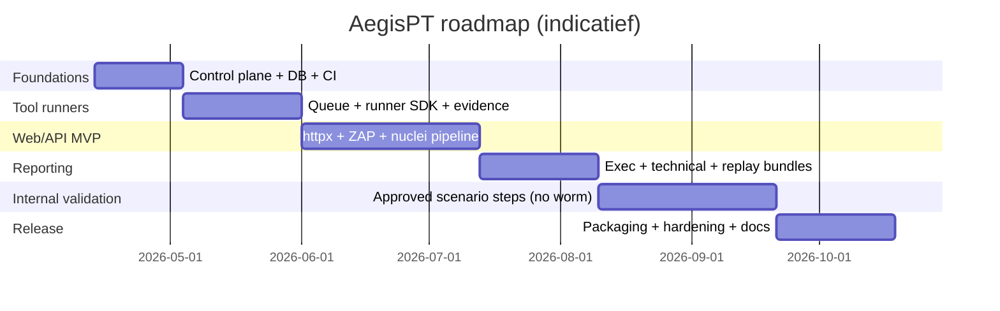

# AegisPT: AI‑ondersteund evidence‑first penetration testing en internal adversary validation op Kali Linux

> **Betrouwbaarheid & false positives:** zie [`docs/reliability-and-false-positives.md`](docs/reliability-and-false-positives.md) —
> hoe betrouwbaar de resultaten zijn (gelaagd), hoe false positives worden afgevangen,
> waarom dekking emergent is (geen WSTG-checklist), en waarom compliance-frameworks
> mapping-views zijn en géén certificeringen. Lees dit vóór je claims maakt richting
> klant of auditor. Methodology-mapping: [`docs/methodology_mapping.md`](docs/methodology_mapping.md).

## Executive summary

AegisPT is te ontwerpen als een **AI‑assisted orkestratie‑ en bewijsplatform** dat bestaande pentesttools op **Kali Linux** samenbrengt, resultaten normaliseert, en vooral: elke bevinding **herleidbaar** maakt naar ruwe, reproduceerbare evidence (inputs, toolversies, configs, outputs, request/response‑artefacten). Kali Linux is expliciet bedoeld voor penetration testing en security auditing, en levert veel van de benodigde tooling als pakketten. citeturn16search20turn2search4

De kernkeuzes voor AegisPT:

- **Evidence‑first boven “AI‑first”**: de AI helpt met plannen, prioriteren, normaliseren en rapporteren, maar elke claim in een rapport moet terug te spelen zijn naar concrete artefacten (bijv. ZAP alerts + HTTP messages, Nuclei JSONL + opgeslagen request/response, Playwright traces). citeturn15search0turn15search9turn7search1  
- **Veilige default‑operatie op Kali**: Kali hanteert een Network Service Policy waarbij extern luisterende services standaard niet persistent enabled worden; AegisPT moet daar expliciet rekening mee houden in deployment (containers, expliciet en gecontroleerd enablement, interne netwerksegmentatie). citeturn18view2turn17search5  
- **Interne validatie zonder autonome worming**: “internal adversary validation” kan wél, maar uitsluitend als **gecontroleerde, expliciet goedgekeurde, replayable scenario’s** (human‑in‑the‑loop, stap‑voor‑stap), bij voorkeur geïnspireerd door adversary emulation plannen (MITRE) i.p.v. zelfpropagerende wormlogica. citeturn13search2turn13search34  
- **Rapportage die twee doelgroepen bedient**: PTES en OWASP‑leidraden benadrukken dat rapportage zowel management als technische teams moet bedienen; AegisPT moet daarom zowel executive samenvatting als technisch bewijsdossier genereren. citeturn12search1turn12search2  

Op MVP‑niveau is het realistisch om AegisPT te leveren als: (1) engagement/scope management, (2) tool‑orkestratie (web/API + beperkte infra), (3) evidence opslag + replay, (4) rapportgenerator, (5) expliciete approval workflow voor “actieve” stappen. Deze invulling sluit aan bij NCSC‑advies: maak doel en onderzoeksvraag concreet, borg scope, en minimaliseer hinder/risico’s. citeturn18view0turn18view1  

## Projectdoelen en scope

AegisPT is het meest waardevol wanneer het **geen nieuwe “scanner”** probeert te zijn, maar een **consistent besturingssysteem** (control plane) en **bewijsadministratie** (evidence plane) rond bewezen tools. In die rol kan AegisPT drie doelen combineren:

1. **Betrouwbare securitytests als kwaliteitscyclus**: NCSC positioneert securitytests expliciet als onderdeel van risicomanagement en kwaliteitscyclus, met het besef dat tests nooit absolute garanties geven. AegisPT moet daarom iteratief en herhaalbaar zijn (scan → fix → retest → verbetertrend). citeturn18view0turn21search15  
2. **Methodisch werken volgens erkende kaders**:  
   - NIST SP 800‑115 beschrijft het plannen/uitvoeren van technische securitytests, het analyseren van findings en het ontwikkelen van mitigatiestrategieën—exact de lifecycle die AegisPT moet ondersteunen. citeturn12search4turn12search0  
   - OWASP WSTG levert een best‑practice testframework voor webapplicaties en webservices (van informatievergaring tot reporting). citeturn12search2turn12search14  
   - OWASP ASVS biedt een basis om webapp security controls systematisch te verifiëren (en kan dienen als “control‑coverage index” in rapportage). citeturn13search3turn13search15  
   - PTES beschrijft het end‑to‑end proces inclusief reporting, met expliciete focus op begrijpelijke output voor verschillende stakeholders. citeturn12search5turn12search1  
3. **Internal adversary validation als gecontroleerde emulatie**: AegisPT kan interne scenario’s modelleren langs MITRE ATT&CK‑gedreven emulation plannen, zodat Red/Blue teams kunnen testen of detectie en respons werken—maar dan als gecontroleerde “runbooks” met expliciete aannames, approvals en evidence. citeturn13search2turn13search6turn13search34  

Niet‑doelen (bewust afbakenen):

- Geen autonoom “worming” of zelfpropagerende logica; dit is operationeel riskant en escalatie‑gevoelig en past niet bij verantwoord testen. De internal validation‑functie moet juist bestaan uit **beperkte, expliciet goedgekeurde, stap‑gebaseerde acties** binnen scope. citeturn18view1turn13search2  
- Geen “zero‑day discovery machine” als productdoel: hoewel AI kan helpen bij code‑review of pattern discovery, is het productrisico (misbruik) en het validatieprobleem (false positives) te groot voor een bedrijfsmatige MVP. NCSC benadrukt bovendien dat testen zekerheid geeft maar geen garanties en dat nieuwe kwetsbaarheden niet altijd gevonden worden. citeturn18view0  

## Juridische en veiligheidskaders

### Autorisatie, scope en opdrachtgeverschap

In Nederland is “hacken” (computervredebreuk) strafbaar wanneer dit wederrechtelijk gebeurt; het Openbaar Ministerie beschrijft dit expliciet als het strafbaar stellen van “het inbreken in een computer”. citeturn20search1  
Daarom moet AegisPT **contract‑ en procesmatig** afdwingen dat een run alleen plaatsvindt met expliciete toestemming en een vastgelegde scope (targets, tijdvenster, methoden). NCSC benadrukt bij testen het belang van concrete onderzoeksvraag, scope en voorbereiding om hinder te beperken. citeturn18view1turn18view0  

Concreet workflow‑advies (te implementeren als product‑gates):

- **Pre‑engagement checklist**: doel/onderzoeksvraag, scope (assets, IP‑ranges, domeinen, API’s), out‑of‑scope, tijdvensters, contact/escalatie, impact‑afspraken. NCSC waarschuwt dat brede/vage scope leidt tot te kostbaar of te oppervlakkig testen. citeturn18view0turn18view1  
- **Black‑box/grey‑box/white‑box parameters** als expliciete engagement‑metadata; NCSC benoemt dat vooraf verstrekte informatie kan verschillen per type pentest (bijv. black‑box zonder inloggegevens). citeturn18view1  

### Privacy en gegevensbescherming

Pentests raken in de praktijk vaak persoonsgegevens (logs, klantdata in responses, accountinformatie). De entity["organization","Autoriteit Persoonsgegevens","nl data protection authority"] geeft aan dat organisaties die persoonsgegevens verwerken beveiligingsmaatregelen moeten nemen. citeturn21search2  
Daarnaast vereist AVG/GDPR art. 32 o.a. passende maatregelen en een proces om maatregelen periodiek te testen en te evalueren—dit sluit functioneel aan bij “continuous validation” maar verhoogt ook de eisen aan dataminimalisatie en beveiligde opslag van testartefacten. citeturn21search28turn21search1  

AegisPT moet daarom standaard:

- **Redaction by design** bieden (tokens, cookies, PII) voordat evidence in centrale storage belandt.  
- **Encryptie en rolgebaseerde toegang** afdwingen op evidence‑objecten, met audittrail.  
- **Retention policies** per engagement ondersteunen (bijv. ruwe HTTP bodies 14 dagen, gehashte samenvatting 1 jaar).  

### Veiligheid van de toolchain en operatie op Kali

Kali Linux hanteert een Network Service Policy: extern luisterende services worden standaard niet persistent enabled, om exposure in een “hostile environment” te minimaliseren. Dit is relevant omdat AegisPT zelf services introduceert (API, workers, databases) en dus expliciete hardening/segmentatie nodig heeft. citeturn18view2  

Verder: Metasploit in Kali laat zien dat zelfs lokale database‑ondersteuning extra stappen vergt omdat services niet standaard op boot draaien; dit onderstreept dat AegisPT deployment expliciet en beheerst moet gebeuren. citeturn17search5turn4search8  

### Security/legal checklist voor “internal validation”

Onderstaande checklist is bedoeld als **product‑enforced gate** vóór elke “active” of “internal validation” run, om te borgen dat AegisPT voldoet aan NCSC‑voorbereidingsadvies en het risico op verstoring minimaliseert. citeturn18view1turn18view0  

| Checklist‑item | Product‑maatregel in AegisPT | Waarom dit essentieel is |
|---|---|---|
| Getekende autorisatie + RoE | Engagement kan pas “armed” worden na upload + 2‑persoons approval | Voorkomt wederrechtelijke inzet (OM) citeturn20search1 |
| Scope as code (allowlist) | CIDR/domeinen/API base URLs als harde allowlist; task‑runner blokkeert buiten scope | NCSC: scope concreet maken, anders te breed/vage test citeturn18view0 |
| Impact‑venster + stop‑knop | Rate limits + globale kill switch per engagement | NCSC: planning om hinder te voorkomen citeturn18view1 |
| Data handling (PII) | Default redaction + encryptie + retention policies | AP/AVG beveiligingseisen citeturn21search2turn21search1 |
| Geen autonome worming | Alleen handmatig goedgekeurde, stap‑run scenario’s; geen self‑propagation primitives | Controlled emulation i.p.v. oncontroleerbare verspreiding citeturn13search2 |

## Toolinventaris en integratiekoppelingen

### Inventaris met officiële bronnen en Kali‑packaging notes

De onderstaande inventaris focust op tools die óf direct in Kali als pakket beschikbaar zijn, óf op een gecontroleerde manier te installeren zijn (bijv. via Kali‑aanbevolen pipx voor niet‑gepackageerde Python apps). Kali adviseert expliciet: **installeer via APT waar mogelijk**, en gebruik **pipx** wanneer iets niet (of te oud) gepackageerd is, omdat pip system‑Python kan breken. citeturn9search9  

| Tool | Rol in AegisPT | Automatiseringsinterface | Kali package / install note |
|---|---|---|---|
| OWASP ZAP | DAST voor web/API; proxy, spider, active/passive scanning | Daemon + API (JSON/HTML/XML); Automation Framework | `zaproxy` (±266.9 MB) `sudo apt install zaproxy`; daemon mode beschikbaar. citeturn5view2turn15search0turn15search4turn15search26 |
| Nuclei | Template‑based vuln checks (HTTP/DNS/TCP/file/etc.) | CLI; workflows/templates; JSONL; option om request/response op te slaan | `nuclei` (±119.9 MB) `sudo apt install nuclei`. Belangrijk: support voor signed/unsigned templates en “disable unsigned templates”. citeturn6view0turn7search1 |
| Playwright | Browser automation voor auth flows, crawling met real browser, evidence via traces | Python/Node APIs; trace collection + trace viewer | In Kali via Debian source `python-playwright` met binary `python3-playwright` (pkg tracker). citeturn9search0turn15search1turn15search9 |
| Semgrep | SAST/secure coding checks, secrets patterns, custom rules | CLI (`semgrep scan` / `semgrep ci`), YAML rule syntax | Niet als standaard Kali toolpagina; installeer als geïsoleerde app (pipx/container) conform Kali guidance. citeturn9search9turn10search10turn15search2turn4search5 |
| Metasploit Framework | Exploit/validation tooling (alleen gecontroleerd, met approvals) | RPC daemon (msfrpcd) + CLI | `metasploit-framework` (±561.3 MB) `sudo apt install metasploit-framework`. DB‑support vraagt expliciete service‑stappen in Kali. citeturn5view1turn4search8turn4search4 |
| Nmap | Netwerk discovery/port scanning/service detectie; basis asset model | CLI; output naar XML; ndiff vergelijkt XML runs | `nmap` (±4.55 MB) `sudo apt install nmap`; `nmap-common`, `ndiff`, `zenmap` beschikbaar. citeturn5view0 |
| httpx (ProjectDiscovery) | HTTP probing/normalisatie (status, titles, tech detect, etc.) | CLI; bulk probing; output normaliseerbaar | In Kali als `httpx-toolkit` om conflict met `python3-httpx` te vermijden. `sudo apt install httpx-toolkit`. citeturn6view1turn4search23turn4search2 |
| ffuf | Content discovery/fuzzing (directories, vhosts, params) | CLI; goed te runner‑wrapen met rate limits | `ffuf` (±9.12 MB) `sudo apt install ffuf`. citeturn6view4turn3search1 |
| feroxbuster | Recursieve content discovery (“forced browsing”) | CLI; state/resume bruikbaar voor replay | `feroxbuster` (±12.28 MB) `sudo apt install feroxbuster`. citeturn6view2turn3search14 |
| testssl.sh | TLS/SSL configs & crypto flaws check, op elke poort | CLI; output te archiveren | `testssl.sh` (±3.52 MB) `sudo apt install testssl.sh`. citeturn6view3turn3search0 |
| llm-tools-nmap (optioneel) | Inspiratie/voorbeeld van “LLM function calling” met Nmap | Plugin voor LLM tool (function calling) | `llm-tools-nmap` via APT; toont dat Kali al LLM‑tool plugins packaged heeft. citeturn4search22 |

image_group{"layout":"carousel","aspect_ratio":"16:9","query":["OWASP ZAP interface screenshot","Kali Linux logo","Nmap network scan output screenshot","Metasploit Framework msfconsole screenshot"],"num_per_query":1}

### Integratiepatronen per tool

**ZAP** moet in AegisPT primair als **daemon + API** draaien, zodat runs deterministisch zijn (zelfde config, add‑ons, contexten). ZAP APIs geven toegang tot kernfeatures zoals active scanner en spider, en zijn enabled in daemon mode. citeturn15search0turn15search4  
Belangrijk is dat AegisPT expliciet een API key afdwingt en netwerktoegang beperkt: ZAP documenteert dat een API key bedoeld is om misbruik door kwaadwillende sites te voorkomen, en dat je alleen vertrouwde IP’s toegang moet geven. citeturn15search20  

**Nuclei** moet als “high‑throughput check engine” gebruikt worden, maar wél met supply‑chain controls. In Kali’s helptekst is zichtbaar dat Nuclei templates kan laten signen en dat je unsigned templates expliciet kunt blokkeren (disable‑unsigned‑templates), en dat het request/response kan opslaan voor bewijs. citeturn7search1turn6view0  
In AegisPT vertaalt dit naar een policy‑gate: alleen templates uit een goedgekeurde feed + signature enforcement.

**Playwright** is in AegisPT vooral waardevol voor (a) authenticated flows, (b) real‑browser crawling waar scanners tekortschieten, en (c) rijk bewijs: Playwright kan traces opnemen die in Trace Viewer bekeken worden. citeturn15search1turn15search9  
Kali’s package tracker laat zien dat `python3-playwright` als binary in Kali‑rolling beschikbaar is via Debian source `python-playwright`. citeturn9search0turn9search4  

**Semgrep** past in AegisPT als SAST‑laag voor codebases (MVP: repo checkout + scan + SARIF/JSON opslag) en als mechanisme om organisatie‑specifieke guardrails te coderen. Semgrep documenteert zowel CLI‑gebruik (`semgrep scan` vs `semgrep ci`) als YAML rule syntax. citeturn10search10turn15search2turn4search5  
Omdat Kali vanaf 2024.4 sterk ontmoedigt om pip direct in system‑Python te gebruiken, moet Semgrep bij voorkeur via pipx/container geïnstalleerd worden wanneer het niet als APT‑pakket beschikbaar is. citeturn9search9  

## Architectuur, agents en evidence‑model

### Overzicht van de planes

AegisPT is het meest robuust als je het ontwerpt als vijf gescheiden planes:

- **Control plane**: engagement, scope, approvals, policies, secrets references, audit log.  
- **Reasoning plane**: LLM/agents plannen en prioriteren, maar kunnen niets direct uitvoeren; output is een “plan” + motivering + vereiste approvals.  
- **Execution plane**: tool runners uitvoeren (containers/isolatie), met harde scope enforcement.  
- **Evidence plane**: artefact store + hashing + metadata (tool versions, configs), replay bundles.  
- **UI plane**: operator UX (wizard‑driven), dashboards, rapporten.

```mermaid
flowchart LR
  U[Operator UI] --> C[Control plane<br/>Engagements • Scope • Policies • Approvals]
  C --> R[Reasoning plane<br/>Agents/LLM planners]
  R -->|Proposed Plan (JSON)| C
  C -->|Approved Tasks| Q[Task Queue]
  Q --> E[Execution plane<br/>Tool Runners]
  E --> V[Evidence plane<br/>Artifacts • Hashes • Metadata]
  V --> C
  V --> REP[Report Generator<br/>Exec + Tech]
  REP --> U
```

De reden om reasoning te scheiden van execution is veiligheidskritisch: het voorkomt dat “AI” rechtstreeks tools kan aansturen zonder policy checks. Dit sluit aan bij NCSC‑benadering: concreet doel, scope, en borging van resultaten. citeturn18view0turn18view1  

### Multi‑agent rollen en interfaces

Een praktische agent‑verdeling (MVP‑proof, later uitbreidbaar):

| Agent | Inputs | Outputs | Scope‑/policy constraints |
|---|---|---|---|
| Scope & Policy Agent (deterministisch) | contractmetadata, allowlist, run profile | policy decision (allow/deny), required approvals | hard‑block buiten allowlist; classificeert “passive/active/intrusive” |
| Recon Agent | asset list, DNS/HTTP probe outputs | genormaliseerd asset model + hypotheses | alleen discovery; rate limiting |
| Auth & Session Agent | login flows, secrets references, Playwright scripts | session evidence + “auth context” config | nooit plaintext secrets opslaan; alleen vault refs |
| DAST Orchestrator Agent | target map, ZAP API capabilities | ZAP automation plan + scan parameters | ZAP API key verplicht; permitted addresses beperken citeturn15search20 |
| Template Scan Agent | target list, approved templates | nuclei run spec + template selection | enable signature enforcement; block unsigned templates waar vereist citeturn7search1 |
| Code Review Agent | repo, policy rules | semgrep config selection + findings triage | pipx/container install; geen system‑pip citeturn9search9 |
| Evidence QA Agent | alle ruwe outputs | “finding packages” met reproducerende stappen | verifieert dat elke finding evidence heeft |
| Reporting Agent | finding packages + risk mapping | executive summary + technische bijlage | PTES/WSTG‑stijl rapportstructuur citeturn12search1turn12search2 |

### Policy/gate‑mechanismen

AegisPT moet policies afdwingen op twee niveaus:

1. **Pre‑execution gates (Control plane)**  
   - Allowlist enforcement (CIDR/domein/API prefix), “time window”, “max concurrency”, “max RPS”.  
   - Approval types: *passive* (auto‑approve), *active* (1 approver), *intrusive* (2‑persoons).  
2. **Run‑time guards (Execution plane wrappers)**  
   - Elke runner valideert targets opnieuw (defense in depth).  
   - Command templates zijn “safe‑wrapped” (geen vrije shell).  
   - Output redaction voordat opslag plaatsvindt.

Tool‑specifiek:

- **ZAP**: AegisPT moet API‑key always‑on en permitted addresses minimal houden; ZAP waarschuwt dat disabling key niet aanbevolen is behalve in volledig geïsoleerde omgeving. citeturn15search20  
- **Nuclei**: templates zijn extreem krachtig; AegisPT moet daarom template provenance afdwingen (bijv. corporate mirror) en, waar mogelijk, unsigned templates blokkeren (nuclei ondersteunt dit expliciet). citeturn7search1  
- **Kali services**: AegisPT mag niet impliciet services “persistent enable” zonder expliciete operatoractie; Kali disallowt persistence standaard. citeturn18view2  

### Evidence‑model en replayability

“Evidence‑first” betekent dat een finding pas “reportable” is als het minimaal dit bewijs heeft:

- **Wie/wat/wanneer**: run_id, engagement_id, target_id, timestamps, operator/approver identity.  
- **Hoe**: tool + versie + runner image digest, config (ZAP automation plan / nuclei flags / semgrep config).  
- **Ruwe output**: originele tool output (JSON/XML/text) + relevante artefacten.  
- **Replay bundle**: machine‑readable “replay recipe” die dezelfde runner met dezelfde inputs kan herhalen.

Concreet per tool:

- ZAP: API‑gedreven scanresultaten + (indien gebruikt) Report Generation API templates/exports; dit maakt consistente rapporten en technische bijlagen mogelijk. citeturn15search12turn15search4  
- Playwright: trace.zip + optioneel screenshots/video; Playwright Trace Viewer ondersteunt het analyseren van opgenomen traces. citeturn15search1turn15search9  
- Nuclei: JSONL of reporting DB export + optioneel opgeslagen request/response (nuclei ondersteunt store‑resp). citeturn7search1  

## MVP, stack en implementatie

### MVP scope

Een MVP die zowel bruikbaar als veilig is:

- Engagements: aanmaken, scope definiëren, run profiles (passive/active), approvals.
- Web/API pipeline: httpx‑probe → target normalization → ZAP passive → (optioneel) ZAP active (approval) → Nuclei checks (policy templates) → evidence packaging.
- Code pipeline: repo import → Semgrep scans → findings normalisatie → evidence.
- Rapportage: executive summary + technische appendix met bewijslinks en reproduceerbare run metadata (PTES‑achtige tweedeling). citeturn12search1turn12search5  
- Interne validatie v1: alleen **pre‑geselecteerde scenario steps**, gebaseerd op adversary emulation plannen (MITRE), met expliciete approvals per stap; geen zelfstandige verspreiding. citeturn13search2turn13search10  

### Tech stack en waarom

- **API**: FastAPI (Python) voor control plane endpoints en worker dispatch.
- **DB**: PostgreSQL voor engagement metadata, findings, approvals.
- **Queue**: Redis als broker; **Celery** *of* **Dramatiq** voor background tasks. Celery positioneert zichzelf als distributed task queue met real‑time processing en scheduling; Dramatiq focust op eenvoud, betrouwbaarheid en performance. citeturn14search2turn14search3turn14search7  
- **Artifacts**: S3‑compatible object store (bijv. MinIO) voor grote evidence artefacten (traces, HAR, ZAP sessions).
- **Runtime isolation**: Docker Compose voor dev/staging; Kubernetes voor productie. Docker beschrijft Compose expliciet als tool om multi‑container apps in één YAML te definiëren en runnen; Kubernetes Deployments beheren sets Pods en doen declarative updates. citeturn14search4turn14search1turn14search0  

### Kali metapackage plan

Doel: een “AegisPT‑operator node” snel kunnen opbouwen op Kali, met alle kern tools geïnstalleerd via APT waar mogelijk.

1. **Base**: kies `kali-linux-headless` of `kali-linux-default` afhankelijk van GUI behoefte. Kali documenteert metapackages als dependency‑bundles om in één keer veel tooling te installeren. citeturn8search4turn10search11  
2. **Custom metapackage**: Kali beschrijft hoe je eigen metapackages maakt door `kali-meta` te clonen en `debian/control` aan te passen; daarna build je met `dpkg-buildpackage` en installeer je de .deb. citeturn22view0  
3. **AegisPT metapackage (voorstel)**: `kali-linux-aegispt` met dependencies zoals: `zaproxy`, `nuclei`, `nmap`, `httpx-toolkit`, `ffuf`, `feroxbuster`, `testssl.sh`, `metasploit-framework`, plus `docker.io`, `pipx`, `python3-venv`. (Semgrep via pipx/container conform Kali guidance). citeturn5view2turn6view0turn5view0turn6view1turn6view4turn6view2turn6view3turn5view1turn9search9  

### Deployment stappen

**Single‑node (Kali) met Docker Compose** (aanbevolen voor MVP):

1. Kali up‑to‑date + metapackages installeren (Kali adviseert update/full‑upgrade vóór metapackage install). citeturn8search4  
2. Docker Engine + Compose installeren (of distro packages) en hardening toepassen (non‑root where applicable). citeturn14search4turn16search25  
3. `docker compose up` voor: api, worker, postgres, redis, minio, zap‑daemon runner containers. Compose beschrijft expliciet het beheren van services/networks/volumes via één YAML. citeturn14search0turn14search4  

**Kubernetes (productie/enterprise)**:

- Gebruik Deployments voor stateless services (api, workers, ui) en StatefulSets voor postgres/minio (of managed services). Kubernetes Deployments bieden declarative updates. citeturn14search1turn14search37  

### Repo structuur

```text
aegispt/
  README.md
  docs/
    architecture.md
    threat-model.md
    runbooks/
  api/
    app/
      main.py
      routers/
      services/
      schemas/
      auth/
      policy/
    tests/
  workers/
    runners/
      zap/
      nuclei/
      nmap/
      httpx/
      playwright/
      semgrep/
    orchestration/
    tests/
  ui/
    web/
  infra/
    compose/
      docker-compose.yml
    k8s/
      base/
      overlays/
  migrations/
  scripts/
    install_kali_deps.sh
    build_runners.sh
```

### API endpoints

| Endpoint | Doel | Belangrijkste gates |
|---|---|---|
| `POST /api/v1/engagements` | Nieuw engagement | Alleen authorized user |
| `POST /api/v1/engagements/{id}/scope` | Scope allowlist uploaden | Schema‑validatie + audit log |
| `POST /api/v1/engagements/{id}/run` | Run aanvragen | Policy engine bepaalt approvals |
| `POST /api/v1/runs/{run_id}/approve` | Approve “active/intrusive” stap | 2‑persoons regel voor high risk |
| `GET /api/v1/runs/{run_id}/evidence` | Evidence index | RBAC + redaction |
| `POST /api/v1/runs/{run_id}/report` | Rapport genereren | Alleen na Evidence QA pass |
| `GET /api/v1/replay/{finding_id}` | Replay bundle | Scope‑locked; read‑only recipe |

### Database schema (tabellen + kernvelden)

| Tabel | Kernvelden (indicatief) | Opmerking |
|---|---|---|
| `engagements` | id, name, client, start/end, roe_ref, status | status: draft/armed/running/closed |
| `scopes` | id, engagement_id, allowlist_json, denylist_json | canonical scope “as code” |
| `run_profiles` | id, name, class(passive/active/intrusive), limits | rate/concurrency caps |
| `runs` | id, engagement_id, profile_id, requested_by, status, started_at | status machine |
| `approvals` | id, run_id, step_id, approver_id, decision | 4‑eyes support |
| `tasks` | id, run_id, tool, target_id, params_json, status | dispatched naar queue |
| `tool_executions` | id, task_id, runner_digest, tool_version, exit_code | reproduceerbaarheid |
| `evidence_artifacts` | id, tool_execution_id, kind, uri, sha256, redaction_state | S3 URI + hash |
| `findings` | id, run_id, title, severity, target_id, evidence_ref, status | status: open/accepted/FP/fixed |
| `audit_events` | id, actor, action, object_type/id, timestamp | compliance |
| `secrets_refs` | id, engagement_id, vault_pointer, purpose | nooit plaintext |

### Container/service definitie (Docker Compose schets)

```yaml
services:
  api:
    build: ./api
    depends_on: [postgres, redis, minio]
    environment:
      DATABASE_URL: postgresql://...
      REDIS_URL: redis://redis:6379/0
      ARTIFACTS_S3_ENDPOINT: http://minio:9000

  worker:
    build: ./workers
    depends_on: [redis, postgres, minio]
    environment:
      REDIS_URL: redis://redis:6379/0

  zapd:
    image: aegispt/runner-zap:latest
    # ZAP daemon behind internal network + API key enforced in config
    networks: [internal]

  postgres:
    image: postgres:16
    volumes: [pgdata:/var/lib/postgresql/data]
    networks: [internal]

  redis:
    image: redis:7
    networks: [internal]

  minio:
    image: minio/minio
    command: server /data
    volumes: [minio:/data]
    networks: [internal]

networks:
  internal:
    driver: bridge

volumes:
  pgdata: {}
  minio: {}
```

### Sample CI/CD

Doel: build/test, image builds, migrations check, policy regression tests.

```yaml
name: ci
on: [push, pull_request]
jobs:
  test:
    runs-on: ubuntu-latest
    steps:
      - uses: actions/checkout@v4
      - uses: actions/setup-python@v5
        with:
          python-version: "3.12"
      - run: pip install -r api/requirements-dev.txt
      - run: pytest -q api/tests
      - run: pytest -q workers/tests

  build-images:
    runs-on: ubuntu-latest
    needs: [test]
    steps:
      - uses: actions/checkout@v4
      - uses: docker/setup-buildx-action@v3
      - run: docker build -t aegispt/api:${{ github.sha }} ./api
      - run: docker build -t aegispt/worker:${{ github.sha }} ./workers
```

## Roadmap en mijlpalen

### Geprioriteerde implementatieroadmap

| Milestone | Inhoud | Effort (person‑weeks) | Deliverables |
|---|---|---:|---|
| Foundations | Repo, CI, DB schema, auth/RBAC, auditlog, scope model | 3 | Werkende control plane skeleton |
| Tool runner framework | Task queue, runner interface, artifact hashing + storage | 4 | Runner SDK + evidence store MVP |
| Web/API pipeline MVP | httpx‑probe → ZAP daemon/API → nuclei; normalisatie naar findings | 6 | End‑to‑end web/API run + bewijs |
| Reporting v1 | Executive + technical appendix, replay bundles, export PDF/HTML | 4 | Rapportgenerator + templates (PTES‑stijl) citeturn12search1 |
| Internal validation v1 | MITRE‑geïnspireerde scenario steps + approvals + evidence | 6 | “Adversary emulation runbooks” zonder worming citeturn13search2 |
| Hardening & release | Policy regression tests, retention, redaction, packaging | 4 | Kali metapackage + install docs citeturn22view0turn8search4 |



### Risicobeperking en approval‑workflow voor internal validation

De aanbevolen workflow is “model‑based emulation” (MITRE) met expliciete controlepunten:

1. **Selecteer runbook** (bijv. “Credentialed lateral movement validation” als serie stappen, niet als self‑propagation). citeturn13search2  
2. **Pre‑flight checks**: scope lock, impact window, rate limits, logging targets. citeturn18view0turn18view1  
3. **Step approvals**: elke stap die “intrusive” is vereist 2‑persoons approval en een realtime stop‑knop.  
4. **Evidence QA**: pas rapporteren als bewijs compleet is (replay recipe + artefact hashes).  
5. **Retest**: herhaal dezelfde runbook‑stappen nadat mitigaties zijn doorgevoerd (kwaliteitscyclus). citeturn18view0turn12search4